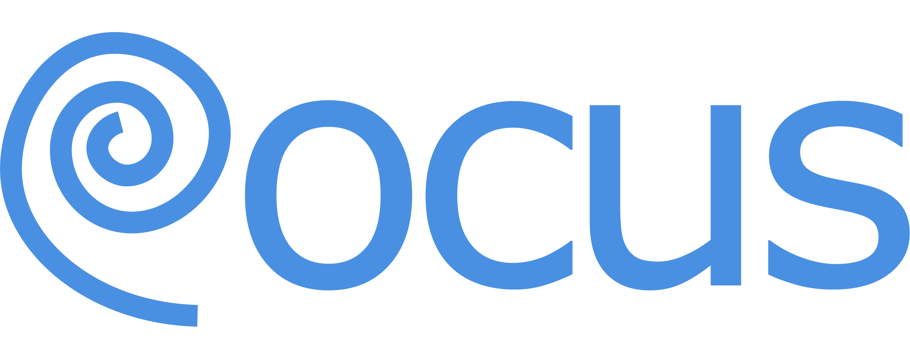

# Rocus



**Rocus** is an intelligent, AI-powered knowledge graph that automatically organizes your saved websites using local machine learning models. Built with Vue.js and D3.js, it's local-first: your graph lives in your browser's IndexedDB, and in **Local mode** the AI runs in your browser too. Cloud mode, sharing and web suggestions are optional, and they use the hosted rocus.io backend. See [What leaves your device](#what-leaves-your-device).

Rocus Extension Github Repo: https://github.com/Othmanali02/rocus-extension

---

## Features

- **Local AI Processing**: An LLM on WebGPU and an embedding model on WASM, both running in your browser (Local mode), or optional Cloud mode for devices without WebGPU
- **Interactive Knowledge Graph**: Visualize relationships between your saved content with D3.js
- **Smart Organization**: Automatically clusters similar websites using embeddings and semantic analysis
- **20+ Themes**: Beautiful, customizable color schemes including "Girly Pop", "Popped Out 80's", and more
- **Search**: Find anything instantly with semantic search
- **Extension**: Save websites with one click
- **Local Storage**: Your graph is stored in IndexedDB in your browser
- **Offline First**: Local mode works offline after the first model download
- **Import/Export**: Backup and restore your entire knowledge graph

---

### Prerequisites

**Browser Support**: **Local mode** needs a browser with **WebGPU support** for the summarization model. Cloud mode and the embedding model work in any modern browser. Check your browser:

- **Chrome/Edge** on Windows, macOS and ChromeOS: works ✅
- **Chrome on Linux**: may need flags (see [Browser Compatibility](#browser-compatibility)) ⚠️
- **Firefox**: Windows and Apple Silicon Macs only; **not on Linux** yet ❌
- **Safari**: untested with Rocus ⚠️

**Check WebGPU Support**: Visit [WebGPU Report](https://webgpureport.org/) to verify your browser and GPU compatibility.

**Hardware Requirements**:
- Local mode: a GPU with WebGPU support (most GPUs from 2018 onwards)
- Recommended: 8GB+ RAM
- 2GB free disk space (for model caching)

### Installation

1. **Clone the repository**:
```bash
   git clone https://github.com/Othmanali02/rocus.git
   cd rocus
```

2. **Install dependencies**:
```bash
   npm install
```

3. **Run the development server**:
```bash
   npm run dev
```

4. **Open in browser**:
   Navigate to `http://localhost:5173`

### First Launch

On first launch, Rocus asks you to choose **Cloud** or **Local** processing (you can change this later in Settings), then:
1. Downloads the MiniLM embedding model (both modes) and, in Local mode only, the Qwen2.5 model (~350MB)
2. Caches the models in your browser so later launches don't download them again
3. Shows an interactive tutorial

**Note**: Initial model download may take 2-5 minutes depending on your connection.

---

## How It Works

### Architecture Overview
```
┌─────────────────────────────────────────────────────────┐
│                     Browser (Client)                    │
├─────────────────────────────────────────────────────────┤
│                                                         │
│  ┌──────────────┐  ┌─────────────┐  ┌──────────────┐    │
│  │   Vue.js     │  │   D3.js     │  │  IndexedDB   │    │
│  │   (UI)       │  │  (Graph)    │  │  (Storage)   │    │
│  └──────────────┘  └─────────────┘  └──────────────┘    │
│                                                         │
│  ┌──────────────────────────────────────────────────┐   │
│  │          Two in-browser ML runtimes              │   │
│  ├──────────────────────────────────────────────────┤   │
│  │  • WebLLM on WebGPU                              │   │
│  │      Qwen2.5-0.5B - summaries + topics           │   │
│  │      (Local mode only; no CPU/WASM fallback)     │   │
│  │  • ONNX Runtime Web on WASM                      │   │
│  │      MiniLM-L6 via Transformers.js 2.17          │   │
│  │      - embeddings (always, every browser)        │   │
│  └──────────────────────────────────────────────────┘   │
│                                                         │
└─────────────────────────────────────────────────────────┘
```

### AI Processing Pipeline

When you save a website via the browser extension:

1. **Content Extraction**: The extension captures page metadata and text content
2. **Summarization**: In Local mode, Qwen2.5-0.5B runs on your GPU through [WebLLM](https://github.com/mlc-ai/web-llm) (WebGPU) and writes a 2-3 sentence summary. In Cloud mode, the backend sends the page to Claude Haiku for the summary.
3. **Topic Extraction**: The same model picks 1-2 word topics for the content
4. **Embedding Generation**: MiniLM-L6 runs on the CPU through [Transformers.js](https://github.com/xenova/transformers.js) 2.17 (ONNX Runtime Web, WASM backend) and turns the summary into a 384-dimensional vector. This always happens in your browser, in both modes.
5. **Clustering**: Cosine similarity groups semantically related websites together
6. **Graph Update**: New nodes and connections are added to your knowledge graph

In Local mode, all of this happens on your machine. See [What leaves your device](#what-leaves-your-device) for the exact list of what is sent in each mode.

### Technology Stack

- **Frontend**: Vue.js 3 (Composition API)
- **Visualization**: D3.js v7
- **AI Models**:
  - [WebLLM](https://github.com/mlc-ai/web-llm) - LLM inference on WebGPU (Qwen2.5-0.5B)
  - [Transformers.js](https://github.com/xenova/transformers.js) 2.17 - ONNX Runtime Web (WASM) for MiniLM embeddings
  - Optional Cloud mode - Claude Haiku via the hosted rocus.io backend
- **Storage**: IndexedDB with file storage import and export
- **Styling**: Tailwind CSS
- **Extension**: Manifest V3 Chrome Extension

---

## User Guide

### Basic Workflow

1. **Install Browser Extension**: Install the Rocus extension for Chrome or Firefox
2. **Browse the Web**: Navigate to any website you want to save
3. **Click Extension Icon**: Choose an album or "Quick Save"
4. **Watch the Magic**: Rocus automatically:
   - Analyzes the content
   - Generates summaries
   - Creates/updates clusters
   - Updates your knowledge graph

### Albums

**Albums** organize clusters by project, topic, or any category you choose.

- **Create Album**: Click albums dropdown → "Create New Album"
- **Assign Content**: Save websites to specific albums via the extension
- **Switch Views**: Use the dropdown to filter by album or view "All Clusters"

### Interacting with the Graph

- **Zoom**: Mouse wheel or pinch gesture
- **Pan**: Click and drag background
- **Explode Cluster**: Click any node to see individual websites
- **Right-Click Menu**:
  - Rename cluster
  - Add websites from database
  - Remove websites
  - Delete cluster
- **Search**: Use the search bar to find clusters/websites instantly

### Themes

Click the theme button (palette icon) to choose from 15+ themes:

### Data Management

**Export**: Settings → Export All Data → Saves `.rocus` file with all clusters, websites, embeddings

**Import**: Settings → Import Data → Restores from `.rocus` backup file

**⚠️ Warning**: Import replaces ALL current data. Backup first!

---

## Backend

Cloud mode, web suggestions, sharing, file uploads and accounts use the hosted backend at rocus.io. **The backend is not open source.** This repo is the frontend only. If you run it yourself in Local mode, saving, summarizing, clustering, search and import/export all work without the backend.

---

## Browser Compatibility

Embeddings and Cloud mode work in any modern browser. The table is about **Local mode**, which needs WebGPU.

| Browser | Platform | Local mode |
|---------|----------|------------|
| Chrome / Edge | Windows, macOS, ChromeOS | ✅ Recommended |
| Chrome / Chromium | Linux | ⚠️ May need flags (below) |
| Firefox 141+ | Windows | ✅ Per Mozilla, untested with Rocus |
| Firefox 145+ | macOS 26 on Apple Silicon | ✅ Per Mozilla, untested with Rocus |
| Firefox | Linux, Android, Intel Macs | ❌ No WebGPU yet (Mozilla says in progress) |
| Safari | macOS, iOS | ⚠️ Untested with Rocus |

Checked on 19 Nov 2026: Firefox 160 on Linux does not expose `navigator.gpu`, so Local mode can't run there. Use Cloud mode, or Chrome.

**Chrome or Chromium on Linux:** on our test laptop (Intel UHD 620, Mesa, Wayland) WebGPU only came up with:

```
chromium --enable-unsafe-webgpu --enable-features=Vulkan --ozone-platform=x11
```

`--ozone-platform=x11` is needed under Wayland, where Vulkan can't be enabled. Then open `chrome://gpu`: WebGPU should say "Hardware accelerated", not "Software only".

**Check compatibility**: [Can I Use WebGPU](https://caniuse.com/webgpu)

**Test your browser**: [WebGPU Report](https://webgpureport.org/)

### Fallbacks

WebLLM only runs on WebGPU, so the summarization model has **no WASM fallback**. Without WebGPU, use Cloud mode. Embeddings still run locally on WASM.

---

## Development

### Project Structure
```
src/
├── components/
│   ├── GraphNode.vue          # Dashboard / graph view
│   └── ...                    # Modals, landing, policy pages
├── composables/
│   ├── graphNode/
│   │   ├── useAIModels.js     # WebLLM + Transformers.js, Local/Cloud mode
│   │   ├── useGraphEngine.js  # Graph state, clustering, IndexedDB
│   │   ├── useDiscover.js     # Opt-in web suggestions
│   │   ├── useSharing.js      # Shared graphs
│   │   └── ...
│   └── useAnalytics.js        # Opt-in Umami analytics
├── router/
├── App.vue
└── main.js
tools/                          # .rocus export format tests
```

The browser extension lives in a separate repo: [rocus-extension](https://github.com/Othmanali02/rocus-extension).

### Building for Production
```bash
npm run build
```

Output will be in `./dist`

---

## Contributing

Contributions are welcome! Please:

1. Fork the repository
2. Create a feature branch (`git checkout -b feature/super-cool-feature`)
3. Commit your changes (`git commit -m 'Add super cool feature'`)
4. Push to the branch (`git push origin feature/super-cool-feature`)
5. Open a Pull Request

---

## License

This project is licensed under the GNU Affero General Public License v3.0 (AGPL-3.0) - see the [LICENSE](LICENSE) file for details.

Rocus was released under the MIT License until 26 September 2026 and is licensed under AGPL-3.0 thereafter.

---

## Acknowledgments

- [Web-LLM](https://github.com/mlc-ai/web-llm) - WebGPU LLM inference
- [Transformers.js](https://github.com/xenova/transformers.js) - In-browser ML models
- [D3.js](https://d3js.org/) - Data visualization
- [Vue.js](https://vuejs.org/) - Progressive framework

---

## Support

- **Issues**: [GitHub Issues](https://github.com/Othmanali02/rocus/issues)
- **Discussions**: [GitHub Discussions](https://github.com/Othmanali02/rocus/discussions)
- **Email**: othman.internet@gmail.com (if applicable)

## What leaves your device

| Feature | Default | What is sent, and where |
|---|---|---|
| Local mode processing | — | Nothing. The models run in your browser. They are downloaded once: MiniLM from Hugging Face, Qwen2.5 from models.rocus.io. |
| Cloud mode processing | Chosen at first run. Nothing is processed before you choose; pages saved from the extension wait on your device. | The page's title and text go to rocus.io, then to Anthropic (Claude Haiku) for the summary. Not stored, and not used for training. |
| Web suggestions / Discover Similar | **Off** | A saved page's topic or search phrase goes to rocus.io, then to Serper (web search). It is only sent after you turn it on in Settings or click "Search once". |
| Sharing a graph | Off | The shared album's graph data goes to rocus.io, so collaborators can load it. |
| File uploads | Only when you add a file (signed in) | The file is stored on rocus.io, and its text goes to Anthropic (Claude Haiku) for the summary. This happens in Local mode too, so Local mode asks before every upload. |
| Analytics | **Off (opt-in)** | Anonymous usage events go to self-hosted Umami. See below. |

Your graph is always stored in your browser's IndexedDB, and Settings → Export saves all of it.

## Privacy-First Analytics

### What We Collect

Rocus uses **[Umami](https://umami.is/)**, a privacy-first, open-source analytics platform, to understand how people use the application. **You must explicitly opt-in** via the consent banner.

**If you consent, we collect:**
- Anonymous page views and button clicks
- Feature usage patterns (e.g., "cluster was exploded")
- Error occurrences to identify bugs
- Browser type and screen size
- Country-level location (derived from IP, not stored)

**We NEVER collect:**
- Your website URLs, titles, or content
- Your cluster names or topics
- Your search queries or any personal data
- IP addresses (not stored)
- Cookies or tracking identifiers
- Device fingerprints
- Any cross-site tracking data

### Why the Analytics?

Anonymous analytics help us:
- Identify which features are most valuable
- Discover bugs and edge cases
- Understand clustering mistakes
- Prioritize improvements
- Support more browsers and devices

### You have full Control

- **Opt out anytime**: Settings → "Help Improve Rocus" toggle off
- **We respect DNT**: Do Not Track browser header is honored
- **Review our code**: See exactly what's tracked in `src/composables/useAnalytics.js`
- **Self-hosted**: Our analytics run on our own server, not third-party services.

### For Privacy Enthusiasts

Rocus is designed with privacy principles
- No surveillance capitalism
- No data brokering
- No dark patterns
- Full transparency
- User control above all else

See our full Privacy Policy for details.
